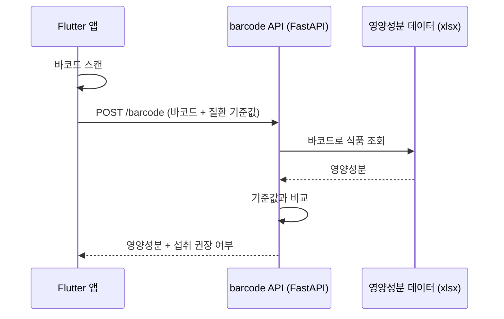

# barcode · 바코드 영양 판별 API

[Forkcast](https://github.com/Chochosongi)의 바코드 판별 서버입니다.
식품 바코드로 영양성분을 조회하고, 사용자의 질환별 섭취 기준(단백질·당·나트륨)을 넘는지 판별해 섭취 권장 여부를 알려줍니다.

<br>

## 동작 흐름



1. 앱이 바코드를 스캔해 바코드 번호와 사용자의 질환 기준값을 보냅니다.
2. 서버는 영양성분 데이터에서 바코드로 식품을 찾습니다.
3. 단백질·당·나트륨 중 **하나라도** 기준을 넘으면 섭취를 권장하지 않는다고 응답합니다.

<br>

## API

### `POST /barcode`

**요청**

| 필드 | 타입 | 설명 |
|---|---|---|
| `barcode` | string | 식품 바코드 번호 |
| `disease_name` | string | 질환명 (응답 안내 문구에 사용) |
| `protein` | float | 단백질 섭취 기준 |
| `sugar` | float | 당 섭취 기준 |
| `sodium` | float | 나트륨 섭취 기준 |

```json
{
  "barcode": "8809027555270",
  "disease_name": "Phenylketonuria (PKU)",
  "protein": 10,
  "sugar": 40,
  "sodium": 1500
}
```

**응답 `200`**

```json
{
  "barcode": "8809027555270",
  "itemName": "darda 슈퍼믹스 팝콘",
  "protein": 8.5,
  "sugar": 0.35,
  "sodium": 468.0,
  "calories": 548.0,
  "notes": "Safe to consume."
}
```

기준을 넘으면 `notes`가 `"Not recommended due to limit excess for: {질환명}"`으로 바뀝니다.

**응답 `404`**: 데이터에 없는 바코드일 때 `{"detail": "해당 바코드 정보 없음"}`을 돌려줍니다.

<br>

## 데이터

| 파일 | 내용 |
|---|---|
| `Nutnutrition_DB.xlsx` | 가공식품 244건의 바코드·식품명·열량·단백질·당·나트륨 |
| `disease_limits.json` | 유전성 대사 질환 50종의 단백질·당·나트륨 제한 기준과 식이 주의사항 |

`disease_limits.json` 항목 예시:

```json
{
  "diseaseId": 1,
  "diseaseName": "Phenylketonuria (PKU)",
  "proteinLimit": 10,
  "sugarLimit": 40,
  "sodiumLimit": 1500,
  "notes": "Strictly limit phenylalanine intake; use medical formula for protein."
}
```

서버는 `disease_limits.json`을 직접 읽지 않습니다. 요청에 담긴 기준값으로 판별하므로, 호출하는 쪽에서 이 데이터의 `proteinLimit`·`sugarLimit`·`sodiumLimit`을 `protein`·`sugar`·`sodium`으로 넣어 보내면 됩니다.

> 이 기준값은 서비스 프로토타입용 참고 수치입니다. 실제 식이 관리는 의료진의 처방을 따라야 합니다.

<br>

## 실행 방법

```bash
pip install -r requirements.txt
python main.py
```

서버가 `http://127.0.0.1:8000`에서 실행됩니다. API 문서는 `http://127.0.0.1:8000/docs`에서 볼 수 있습니다.

<br>

## 기술 스택

Python · FastAPI · Uvicorn · pandas · openpyxl · Pydantic
